## [Introduction]{.dtu-kicker} Who am I?

::: notes
(1:30) I sit between naval architecture and data science, and between academia and industry.

\[Hook, said on the title slide just before: "Hands up if your fleet or your clients' ships carry a motion sensor or an IMU on board."\]
:::

[My research field:]{.dtu-blue style="position: absolute; top: 150px; left: 60px; font-weight: 700; font-size: 0.8em;"} [*The estimation of metocean variables based on response measurements on board floating vessels.*]{style="position: absolute; top: 180px; left: 60px; width: 880px; font-size: 0.8em;"}

<!-- Timeline -->

::: {.dtu-timeline style="position: absolute; top: 250px; left: 60px; width: 880px;"}
[**2016–2020**<br>Engineering degree<br>École Centrale de Lyon<br>(FR)]{.tl-item style="left: 0px;"} [**2018–2020**<br>MSc in Mechanical Engineering<br>DTU (DK)]{.tl-item style="left: 180px;"} [**2020–2023**<br>Double PhD<br>DTU (DK) & NTNU (NO)]{.tl-item style="left: 360px;"} [**2024–now**<br>Postdoc, DTU<br>Co-PI of WEFOSWAB (2024–2027): *"Wave estimation and forecasting using ships as wave buoys"*]{.tl-item style="left: 540px;"} [**May 2026**<br>Member of DS/S-262]{.tl-item style="left: 720px;"}
:::

::: {style="position: absolute; top: 430px; left: 60px; width: 880px; font-size: 0.68em; line-height: 1.4;"}
[**Awards:**]{.dtu-blue} Best Paper Presented by a Young Researcher, IEEE MetroSea 2024 · Maenosono award 2026 (Japan)

[**Coordinator of:**]{.dtu-blue} LY300 course on ship hydrostatics and stability (DTU)
:::

<!-- Partner strip -->

::: {style="position: absolute; top: 540px; left: 60px; width: 1180px; font-size: 0.6em;"}
[**Main partners from academia and industry:**]{.dtu-blue} Kobe University (JP), University of Exeter (UK), Met Office (UK), Oshen (UK), Maersk (DK), DNV (NO), NTNU (NO), MOBILIS (FR).
:::

{fig-alt="Kobe University logo" style="max-width: none; max-height: none; position: absolute; top: 600px; left: 60px; height: 50px;"}

{fig-alt="NTNU logo" style="max-width: none; max-height: none; position: absolute; top: 600px; left: 200px; height: 38px; padding: 6px 10px; border-radius: 6px; background-color: #2F3EEA;"}

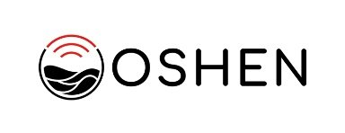{fig-alt="Oshen logo" style="max-width: none; max-height: none; position: absolute; top: 600px; left: 330px; height: 50px;"}

<!-- Logos with wide white margins are cropped with object-fit: cover -->

{fig-alt="Maersk logo" style="max-width: none; max-height: none; position: absolute; top: 607px; left: 490px; width: 162px; height: 36px; object-fit: cover;"}

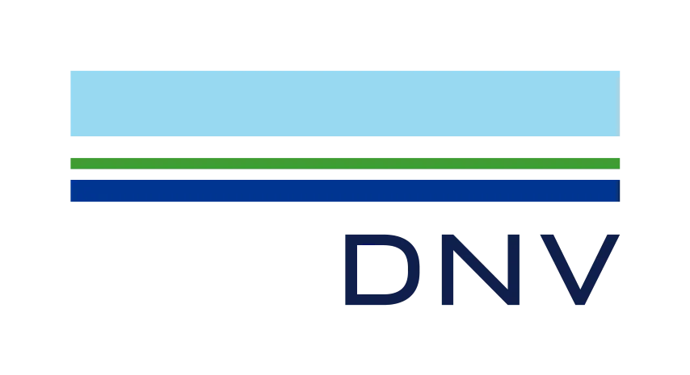{fig-alt="DNV logo" style="max-width: none; max-height: none; position: absolute; top: 600px; left: 680px; width: 116px; height: 50px; object-fit: cover;"}

```{=html}
<!-- Met Office: the logo only fills x = 268-765, y = 100-540 px of the 1024 x 675 file,
     so it is cropped in a 56 x 50 px window (scale 50/440). -->
```

::: {style="position: absolute; top: 610px; left: 825px; width: 56px; height: 50px; overflow: hidden;"}
{fig-alt="Met Office logo" style="max-width: none; max-height: none; position: absolute; top: -11px; left: -30px; width: 116px; height: 77px; margin: 0;"}
:::

{fig-alt="University of Exeter logo" style="max-width: none; max-height: none; position: absolute; top: 600px; left: 905px; width: 148px; height: 50px; object-fit: cover;"}

{fig-alt="MOBILIS logo" style="max-width: none; max-height: none; position: absolute; top: 597px; left: 1080px; width: 50px; height: 56px; object-fit: cover;"}

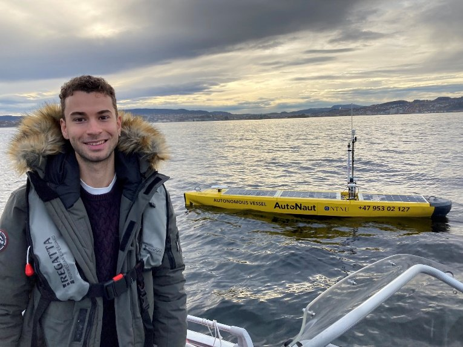{fig-alt="The author on a boat next to an autonomous surface vessel" style="max-width: none; max-height: none; position: absolute; top: 150px; left: 980px; width: 270px;"}

## [Introduction]{.dtu-kicker} Four questions

::: notes
(0:30) This talk answers four questions, and the fourth one is for you.
:::

::: {.dtu-box style="position: absolute; top: 200px; left: 60px; width: 270px; height: 220px; text-align: center;"}
[1]{.dtu-blue style="font-size: 2.5em; font-weight: 700;"}

Why do we need wave data?
:::

::: {.dtu-box style="position: absolute; top: 200px; left: 360px; width: 270px; height: 220px; text-align: center;"}
[2]{.dtu-blue style="font-size: 2.5em; font-weight: 700;"}

How is it obtained today?
:::

::: {.dtu-box style="position: absolute; top: 200px; left: 660px; width: 270px; height: 220px; text-align: center;"}
[3]{.dtu-blue style="font-size: 2.5em; font-weight: 700;"}

How can a ship act as a wave buoy?
:::

::: {.dtu-box style="position: absolute; top: 200px; left: 960px; width: 270px; height: 220px; text-align: center; background-color: #2F3EEA; color: white;"}
[4]{style="font-size: 2.5em; font-weight: 700;"}

What could this mean for standards?
:::

[Question 4 is for you!]{.dtu-blue style="position: absolute; top: 450px; left: 960px; width: 270px; text-align: center; font-style: italic; font-size: 0.8em;"}

<!-- ======================================================================= -->

<!-- BLOCK B: WHY WAVE DATA (2:20–4:20)                                       -->

<!-- ======================================================================= -->

## [Why wave data?]{.dtu-kicker} Your insights

::: notes
(0:30) What can wave data be used for? I will show you some examples, but first I want to hear your ideas. Please write them in the word cloud by joining the Vevox session.
:::

```{=html}
<!-- Vevox embed code from the Vevox platform (vevox.app allows embedding).
     Sized to the slide instead of the suggested 100% / min-height 800px, which would overflow. -->
```

::: {style="position: absolute; top: 115px; left: 60px; width: 1160px; height: 560px;"}
```{=html}
<iframe data-src="https://dtu.display.vevox.com#/present/997598/T41IMTK146UW8NSFDMH7" width="1160" height="560"
        frameborder="0" style="border: 0;" allow="fullscreen" allowfullscreen
        title="Vevox"></iframe>
```
:::

## [Why wave data?]{.dtu-kicker} Waves drive cost, safety and structural life

::: notes
(1:00) Because waves are the fundamental driver of most of the processes we are concerned about (as maritime engineers, naval architects, or ocean scientists).

Every key operational decision on a ship depends on a wave estimate.

- Analysing wave-structure interactions before/during/after operations
- Collecting historical wave data for design and rule specifications
- Understanding weather and climate (mechanisms of surface-water mixing and air-sea fluxes)
:::

<!-- Column 1: fuel and emissions -->

[Fuel and emissions]{.dtu-blue style="position: absolute; top: 160px; left: 40px; font-weight: 700; font-size: 0.85em;"}

::: {.dtu-box style="position: absolute; top: 200px; left: 40px; width: 380px; font-size: 17px;"}
Added resistance in waves, weather routing, CII and EU ETS exposure.

**Global shipping** contributes by [\~ 3%]{.dtu-blue} to worldwide anthropogenic emissions of greenhouse gases (IMO, 2020).
:::

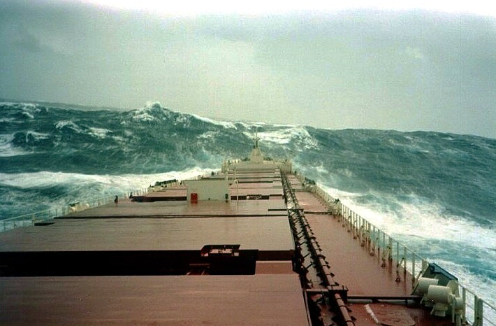{fig-alt="A ship sailing through heavy seas" style="max-width: none; max-height: none; position: absolute; top: 360px; left: 40px; width: 380px;"}

[["Waves of Silence"](https://www.flickr.com/photos/8706293@N06/2986788490) by [Joe Thomissen](https://www.flickr.com/photos/8706293@N06) is licensed under [CC BY-SA 2.0](https://creativecommons.org/licenses/by-sa/2.0/).]{.dtu-credit style="position: absolute; top: 625px; left: 40px; width: 380px;"}

<!-- Column 2: safety -->

[Safety]{.dtu-blue style="position: absolute; top: 160px; left: 450px; font-weight: 700; font-size: 0.85em;"}

::: {.dtu-box style="position: absolute; top: 200px; left: 450px; width: 380px; font-size: 17px;"}
Parametric roll and container losses.

Over the past 10 years, an average of **1,274 containers** have been lost at sea annually (IMO, 2025).
:::

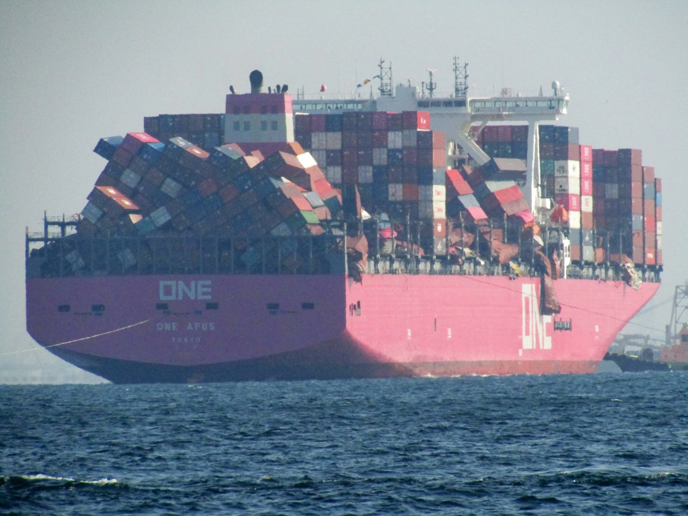{fig-alt="The container ship ONE Apus with collapsed container stacks after losing containers at sea" style="max-width: none; max-height: none; position: absolute; top: 360px; left: 450px; width: 380px; height: 249px; object-fit: cover;"}

[ONE Apus as it arrived in Kobe, Japan, December 8, 2020. Photo: Twitter \@mrnkA4srnrA]{.dtu-credit style="position: absolute; top: 625px; left: 450px; width: 380px;"}


<!-- Column 3: structure -->

[Structure]{.dtu-blue style="position: absolute; top: 160px; left: 860px; font-weight: 700; font-size: 0.85em;"}

::: {.dtu-box style="position: absolute; top: 200px; left: 860px; width: 380px; font-size: 17px;"}
Fatigue and hull girder loads.

**Historical wave and response data** need to be collected for design and (predictive) maintenance.
:::

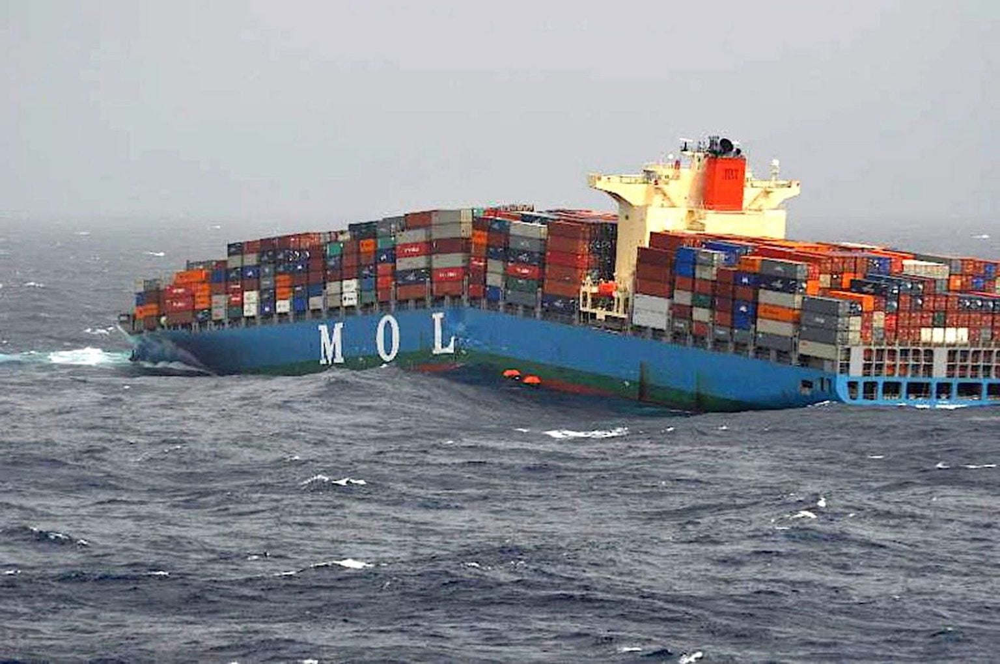{fig-alt="The container ship MOL Comfort broken in two in the Indian Ocean" style="max-width: none; max-height: none; position: absolute; top: 360px; left: 860px; width: 380px; height: 249px; object-fit: cover;"}

[The MV MOL Comfort after structural failure on June 17, 2013 in the Indian Ocean]{.dtu-credit style="position: absolute; top: 625px; left: 860px; width: 380px;"}

## [Why wave data?]{.dtu-kicker} The observation gap

::: notes
(1:00) Wave sensors are sparse and coastal, while ships are everywhere wave data is missing. Shows the potential of having any ship as a sailing wave buoy
:::

[Scientific wave buoys]{.dtu-blue style="position: absolute; top: 160px; left: 40px; font-weight: 700; font-size: 0.8em;"}

<!-- Screenshot of the NDBC map (the site cannot be embedded: www.ndbc.noaa.gov sends
     "X-Frame-Options: deny"). The credit links to the live map. -->
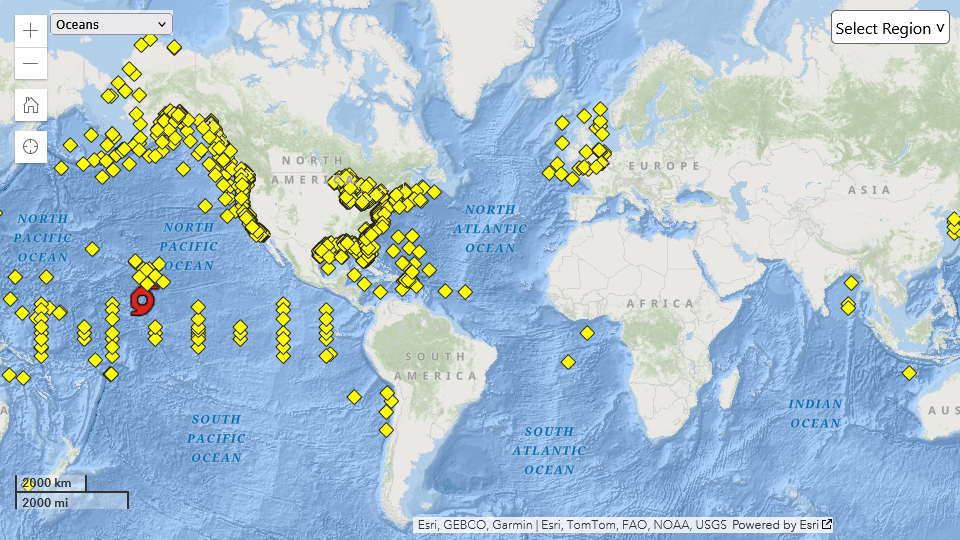{fig-alt="World map of NOAA NDBC station locations, shown as yellow markers, concentrated along the coasts of North America" style="max-width: none; max-height: none; position: absolute; top: 200px; left: 40px; width: 590px; height: 332px; object-fit: cover;"}

[Map: [NOAA National Data Buoy Center](https://www.ndbc.noaa.gov/obs.shtml?lat=20.000000&lon=-120.000000&zoom=2&type=oceans&status=r&pgm=&op=&ls=n){target="_blank"}, retrieved 9 November 2026.]{.dtu-credit style="position: absolute; top: 548px; left: 40px; width: 590px;"}

[Ship traffic (AIS density)]{.dtu-blue style="position: absolute; top: 160px; left: 650px; font-weight: 700; font-size: 0.8em;"}

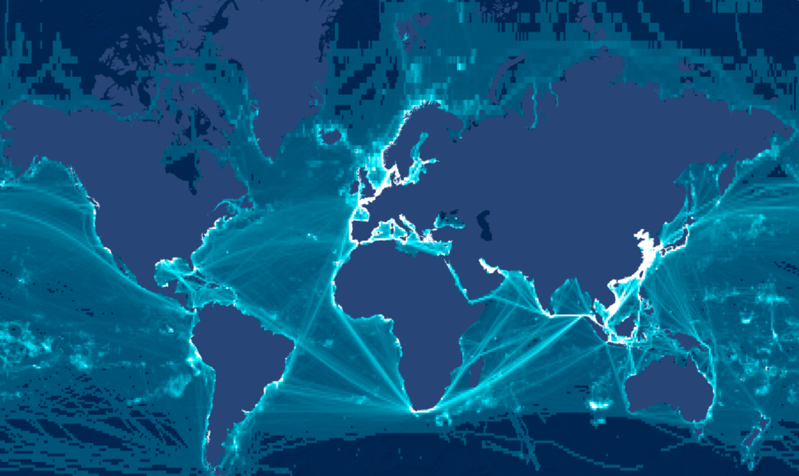{fig-alt="World map of vessel traffic density, with bright shipping lanes crossing all oceans" style="max-width: none; max-height: none; position: absolute; top: 200px; left: 650px; width: 590px; height: 332px; object-fit: cover;"}

[Map: [Global Fishing Watch](https://globalfishingwatch.org/map), vessel traffic, September 2026.]{.dtu-credit style="position: absolute; top: 548px; left: 650px; width: 590px;"}

::: {style="position: absolute; top: 585px; left: 40px; width: 1000px; font-style: italic; font-size: 0.7em; line-height: 1.4;"}
"\[S\]ampling is such a dull word. Nevertheless, the concept is of immense importance. Most of the previous century could be called a century of [undersampling]{.dtu-blue}." [– **Walter H. Munk**, April 2002]{style="font-style: normal;"}
:::

{fig-alt="Portrait of Walter H. Munk in 1956" style="max-width: none; max-height: none; position: absolute; top: 570px; left: 1080px; height: 90px;"}

[[Munk in 1956](https://upload.wikimedia.org/wikipedia/en/4/42/Walter_Munk_1956.jpg)]{.dtu-credit style="position: absolute; top: 670px; left: 1080px;"}

<!-- ======================================================================= -->

<!-- BLOCK C: TECHNOLOGIES (4:20–6:20)                                        -->

<!-- ======================================================================= -->

## [How is it obtained today?]{.dtu-kicker} How the sea state is estimated today

::: notes
(1:00) No single technology gives coverage, resolution, direction and low cost at once.

The specific use-case (previous slide) may set different requirements to availability and updating-frequency.
:::

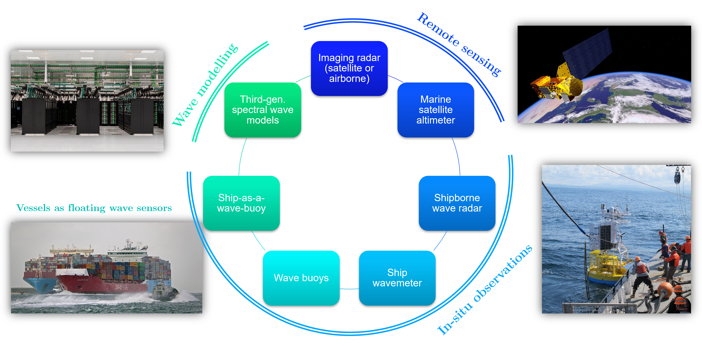{fig-alt="SSE technologies: wave modelling (third-generation spectral wave models), remote sensing (imaging radar, marine satellite altimeter), in-situ observations (wave buoys, ship wavemeter, shipborne wave radar) and vessels as floating wave sensors (ship-as-a-wave-buoy)" style="max-width: none; max-height: none; position: absolute; top: 100px; left: 315px; width: 650px;"}

<!-- Qualitative table. Ratings (as set by the author): 🙂 = +, 😐 = ~, 🙁 = −. -->
::: {style="position: absolute; top: 448px; left: 160px; width: 960px;"}
```{=html}
<style>
  .reveal .sse-table { width: 100%; border-collapse: collapse; font-size: 14px; line-height: 1.1; }
  .reveal .sse-table th { font-weight: 700; padding: 2px 6px; border-bottom: 2px solid #2F3EEA; text-align: center !important; vertical-align: bottom; }
  .reveal .sse-table th:first-child, .reveal .sse-table td:first-child { text-align: left !important; width: 250px; }
  .reveal .sse-table td { padding: 0px 6px; border-bottom: 1px solid #fff; text-align: center !important; vertical-align: middle; }
  .reveal .sse-table td.r { font-size: 20px; line-height: 1.15; }
  .reveal .sse-table td.p { background-color: rgba(31, 208, 130, 0.22); }
  .reveal .sse-table td.z { background-color: rgba(246, 208, 77, 0.30); }
  .reveal .sse-table td.n { background-color: rgba(232, 63, 72, 0.18); }
  .reveal .sse-table td small { color: #666; font-size: 12px; }
  .reveal .sse-table tr.ship td { border-top: 3px solid #2F3EEA; border-bottom: 3px solid #2F3EEA; }
  .reveal .sse-table tr.ship td:first-child { color: #2F3EEA; font-weight: 700; }
</style>
<table class="sse-table">
  <thead>
    <tr><th>Technology</th><th>Spatial<br>coverage</th><th>Time<br>resolution</th><th>Directional<br>information</th><th>Cost</th><th>Available at the<br>ship's position</th></tr>
  </thead>
  <tbody>
    <tr><td><b>Wave models</b> <small>(ERA5, WAM)</small></td><td class="r p">🙂</td><td class="r z">😐</td><td class="r p">🙂</td><td class="r n">🙁</td><td class="r z">😐</td></tr>
    <tr><td><b>Satellites</b> <small>(altimetry, SAR)</small></td><td class="r z">😐</td><td class="r z">😐</td><td class="r n">🙁</td><td class="r n">🙁</td><td class="r n">🙁</td></tr>
    <tr><td><b>Buoys</b></td><td class="r n">🙁</td><td class="r p">🙂</td><td class="r p">🙂</td><td class="r n">🙁</td><td class="r n">🙁</td></tr>
    <tr><td><b>Shipborne radar</b> <small>(e.g. WaMoS)</small></td><td class="r n">🙁</td><td class="r p">🙂</td><td class="r p">🙂</td><td class="r n">🙁</td><td class="r p">🙂</td></tr>
    <tr class="ship"><td>Ship as a wave buoy</td><td class="r n">🙁</td><td class="r p">🙂</td><td class="r p">🙂</td><td class="r p">🙂</td><td class="r p">🙂</td></tr>
  </tbody>
</table>
<div style="margin-top: 4px; font-size: 12px; color: #555; text-align: right;"><span style="background: rgba(31,208,130,0.22); padding: 1px 6px;">🙂 strength</span> &nbsp; <span style="background: rgba(246,208,77,0.30); padding: 1px 6px;">😐 partial</span> &nbsp; <span style="background: rgba(232,63,72,0.18); padding: 1px 6px;">🙁 weakness</span></div>
```
:::

## [How is it obtained today?]{.dtu-kicker} "Observed" waves are estimates too

::: notes
(1:00) Every wave value used in practice carries uncertainty, but standards rarely say how large it is. This slide sets up the standards discussion.
:::

<!-- 1. Map of the C-star track around buoy E1 (1133 x 1222 px, shown at 470 px high) -->
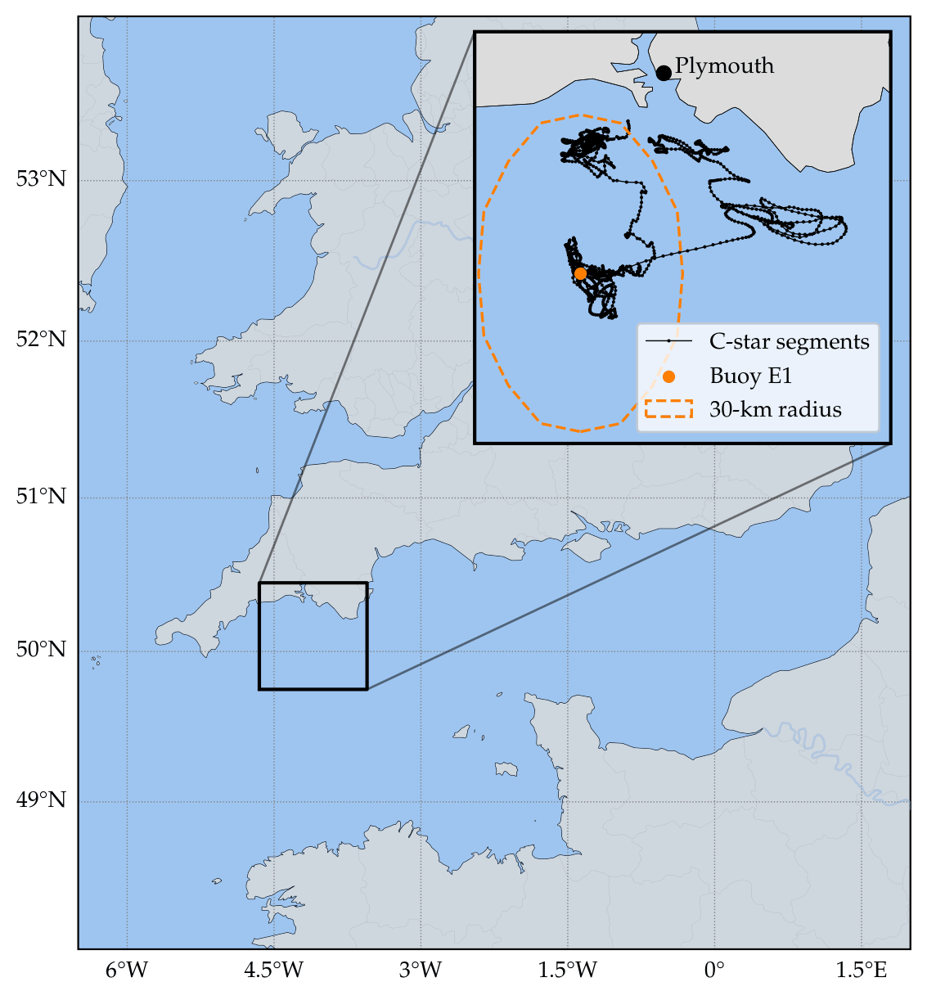{.fragment fragment-index="1" fig-alt="Map of the English Channel with an inset off Plymouth showing the C-star track segments around buoy E1, within a 30 km radius" style="max-width: none; max-height: none; position: absolute; top: 105px; left: 30px; height: 470px;"}

<!-- 2. C-star photo, inset in the lower-left corner of the map (sea / Brittany area, clear of the zoom box) -->
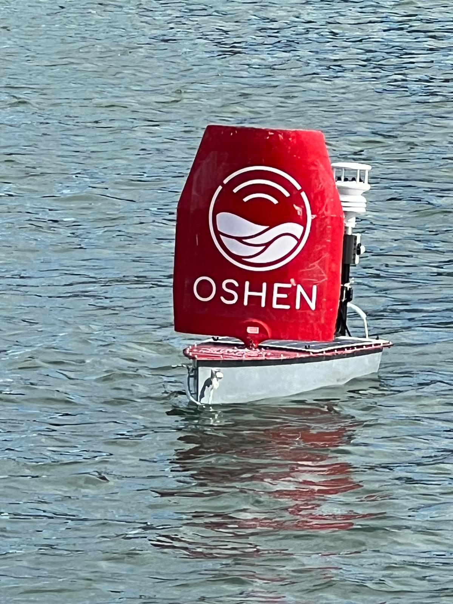{.fragment fragment-index="1" fig-alt="The Oshen C-star autonomous surface vessel at sea" style="max-width: none; max-height: none; position: absolute; top: 438px; left: 68px; width: 110px; height: 110px; object-fit: cover; object-position: 50% 45%; border: 3px solid white; box-shadow: 0 2px 6px rgba(0,0,0,0.4);"}
[The Oshen C-Star autonomous surface vessel]{.fragment fragment-index="1" style="position: absolute; top: 518px; left: 190px; width: 150px; font-size: 11px; line-height: 1.25; font-style: italic; background-color: rgba(255,255,255,0.85); padding: 2px 5px; border-radius: 3px;"}

<!-- 3. Hm0: C-star estimate vs buoy E1 -->
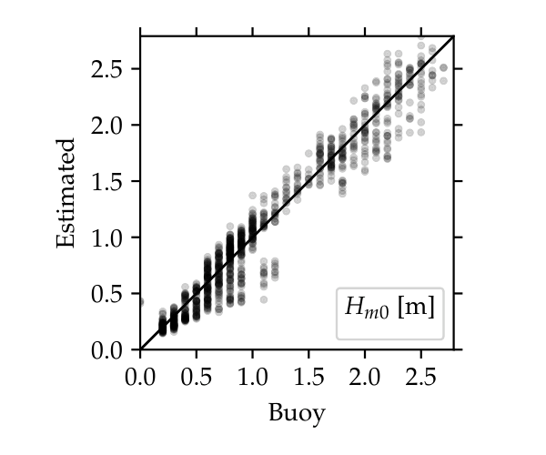{.fragment fragment-index="2" fig-alt="Scatter plot of significant wave height Hm0 estimated from the C-star versus measured by buoy E1, from 0 to 2.7 m, clustered around the diagonal" style="max-width: none; max-height: none; position: absolute; top: 160px; left: 480px; height: 300px;"}

<!-- 4. Wave spectra: medians and interquartile ranges, C-star vs buoy E1 -->
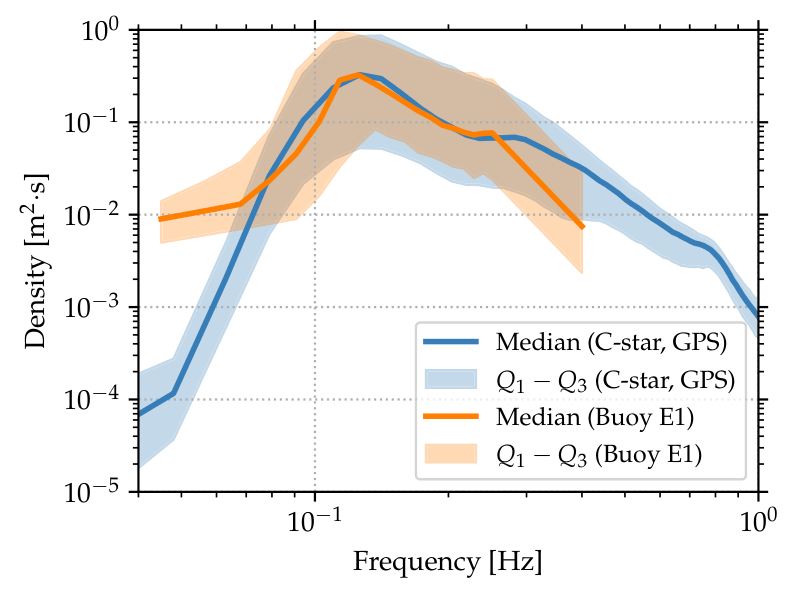{.fragment fragment-index="3" fig-alt="Wave spectral density versus frequency: medians and interquartile ranges for the C-star (GPS) and buoy E1, overlapping around the spectral peak near 0.12 Hz" style="max-width: none; max-height: none; position: absolute; top: 160px; left: 845px; height: 300px;"}

[C-star track around buoy E1 off Plymouth (left); significant wave height $H_{m0}$ estimated from the C-star versus measured by buoy E1 (middle); wave spectra from both platforms (right). From [Mounet et al. (2026b)]{.dtu-blue}, OMAE 2026.]{.fragment fragment-index="1" style="position: absolute; top: 590px; left: 30px; width: 1220px; font-size: 13px; line-height: 1.3; color: #444;"}
[Sailing through the English Channel: whose wave heights would you trust, the buoy's or the C-star's?]{.dtu-blue style="position: absolute; top: 500px; left: 500px; width: 740px; text-align: center; font-weight: 700; font-size: 0.85em;"}

<!-- ======================================================================= -->

<!-- BLOCK D: THE WAVE-BUOY ANALOGY (6:20–9:20)                               -->

<!-- ======================================================================= -->

## [How can a ship act as a wave buoy?]{.dtu-kicker} A ship is a large, imperfect wave buoy

::: notes
(1:30) - Measurements of the buoy’s motions are processed to give the wave spectrum in real-time and at the buoy’s exact position.
- Can we do the same with a ship...?? Yes!A ship filters waves into motions; reverse the filter and you recover the waves. The buoy-to-ship swap (last step) is the key moment of the talk.
:::

[Nielsen et al. (2023)]{style="position: absolute; top: 120px; left: 1060px; width: 200px; text-align: right; font-style: italic; font-size: 0.65em;"}

<!-- Hydrodynamic transfer functions (the "filter") -->

::: {.fragment fragment-index="3" style="position: absolute; top: 326px; left: 347px; width: 611px; height: 359px; border-radius: 50%; background: linear-gradient(to bottom, rgba(47,62,234,0) 0%, rgba(47,62,234,1) 100%); z-index: 5; color: white; text-align: center; font-size: 0.75em;"}
[Transfer functions (the "filter")<br>or *Machine learning*]{style="position: absolute; left: 0; right: 0; bottom: 48px; line-height: 1.25;"}
:::

<!-- The buoy is shown first and is replaced by the ship (step 6) -->

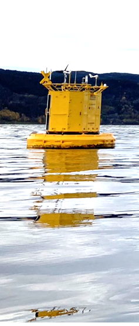{.fragment .fade-out fragment-index="6" fig-alt="A yellow wave buoy in the water" style="max-width: none; max-height: none; position: absolute; top: 152px; left: 530px; width: 224px; height: 460px; object-fit: cover;"}

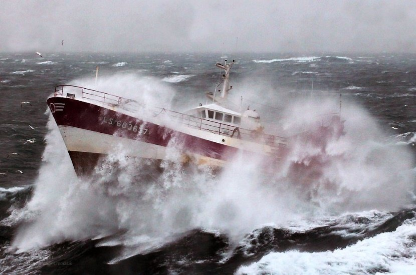{.fragment fragment-index="6" fig-alt="A fishing vessel in heavy seas" style="max-width: none; max-height: none; position: absolute; top: 155px; left: 352px; width: 600px; height: 346px; object-fit: cover; object-position: bottom;"}

[["French Fishing Vessel 'Alf' in the Irish Sea"](https://www.flickr.com/photos/48399297@N04/8675799490) by [Defence Images](https://www.flickr.com/photos/48399297@N04) is licensed under [CC BY-SA 2.0](https://creativecommons.org/licenses/by-sa/2.0/).]{.dtu-credit .fragment fragment-index="6" style="position: absolute; top: 650px; left: 10px; width: 330px;"}

<!-- The four boxes of the loop -->

[Measured motions]{.fragment fragment-index="1" style="position: absolute; top: 156px; left: 751px; width: 200px; text-align: right; font-size: 0.7em; line-height: 1.2; background-color: rgba(255,255,255,0.75); padding: 2px 6px;"}

[Motion spectra]{.fragment fragment-index="2" style="position: absolute; top: 400px; left: 1030px; width: 200px; text-align: center; font-size: 0.7em; line-height: 1.2;"}

[Directional wave spectrum]{.fragment fragment-index="4" style="position: absolute; top: 368px; left: 110px; width: 180px; text-align: center; font-size: 0.7em; line-height: 1.2;"}

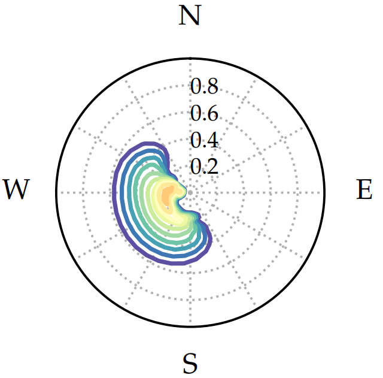{.fragment fragment-index="4" fig-alt="Small polar plot of a directional wave spectrum" style="max-width: none; max-height: none; position: absolute; top: 412px; left: 8px; width: 185px;"}

[$H_s$, $T_p$, direction]{.fragment fragment-index="5" style="position: absolute; top: 156px; left: 352px; width: 170px; font-size: 0.7em; line-height: 1.2; background-color: rgba(255,255,255,0.75); padding: 2px 6px;"}

<!-- Curved arrows of the loop, one per build step -->

::: {.fragment fragment-index="2" style="position: absolute; top: 0px; left: 0px; width: 1280px; height: 720px; pointer-events: none;"}
```{=html}
<svg width="1280" height="720" viewBox="0 0 1280 720" xmlns="http://www.w3.org/2000/svg">
  <defs><marker id="ah2" markerWidth="10" markerHeight="10" refX="8" refY="5" orient="auto"><path d="M0,0 L10,5 L0,10 z" fill="black"/></marker></defs>
  <path d="M 955 185 C 1080 185, 1135 240, 1135 382" fill="none" stroke="black" stroke-width="3" marker-end="url(#ah2)"/>
</svg>
```
:::

::: {.fragment fragment-index="3" style="position: absolute; top: 0px; left: 0px; width: 1280px; height: 720px; pointer-events: none;"}
```{=html}
<svg width="1280" height="720" viewBox="0 0 1280 720" xmlns="http://www.w3.org/2000/svg">
  <defs><marker id="ah4" markerWidth="10" markerHeight="10" refX="8" refY="5" orient="auto"><path d="M0,0 L10,5 L0,10 z" fill="black"/></marker></defs>
  <path d="M 1135 452 C 1135 580, 1060 625, 935 618" fill="none" stroke="black" stroke-width="3" marker-end="url(#ah4)"/>
</svg>
```
:::

::: {.fragment fragment-index="4" style="position: absolute; top: 0px; left: 0px; width: 1280px; height: 720px; pointer-events: none;"}
```{=html}
<svg width="1280" height="720" viewBox="0 0 1280 720" xmlns="http://www.w3.org/2000/svg">
  <defs><marker id="ah5" markerWidth="10" markerHeight="10" refX="8" refY="5" orient="auto"><path d="M0,0 L10,5 L0,10 z" fill="black"/></marker></defs>
  <path d="M 420 640 C 260 640, 200 570, 200 462" fill="none" stroke="black" stroke-width="3" marker-end="url(#ah5)"/>
</svg>
```
:::

::: {.fragment fragment-index="5" style="position: absolute; top: 0px; left: 0px; width: 1280px; height: 720px; pointer-events: none;"}
```{=html}
<svg width="1280" height="720" viewBox="0 0 1280 720" xmlns="http://www.w3.org/2000/svg">
  <defs><marker id="ah6" markerWidth="10" markerHeight="10" refX="8" refY="5" orient="auto"><path d="M0,0 L10,5 L0,10 z" fill="black"/></marker></defs>
  <path d="M 200 362 C 200 230, 235 185, 346 185" fill="none" stroke="black" stroke-width="3" marker-end="url(#ah6)"/>
</svg>
```
:::

## [How can a ship act as a wave buoy?]{.dtu-kicker} Why ships are harder to "read" than buoys

::: notes
(1:00) Three difficulties separate a ship from a buoy, and my research addresses each one. The three tags come back on the outcome slides.
:::

::: {.dtu-box .fragment fragment-index="1" style="position: absolute; top: 140px; left: 60px; width: 360px; height: 520px;"}
[Size]{.dtu-tag}

 

A large ship **ignores short waves**: its motions filter them out.
:::

::: {.dtu-box .fragment fragment-index="2" style="position: absolute; top: 140px; left: 460px; width: 360px; height: 520px;"}
[Forward speed]{.dtu-tag}

 

The **Doppler shift** distorts the wave frequencies that the ship encounters.
:::

::: {.dtu-box .fragment fragment-index="3" style="position: absolute; top: 140px; left: 860px; width: 360px; height: 520px;"}
[Uncertain filter]{.dtu-tag}

 

The **loading condition** and **speed** change the transfer functions.
:::

<!-- One picture per box (336 x 250 px, bottom of each box) -->
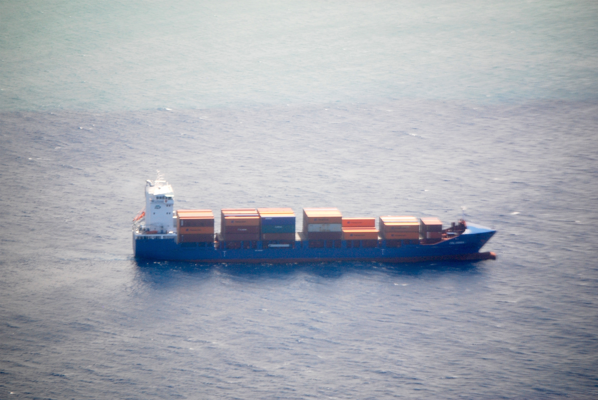{.fragment fragment-index="1" fig-alt="A small container feeder ship at sea, seen from above" style="max-width: none; max-height: none; position: absolute; top: 395px; left: 72px; width: 336px; height: 250px; object-fit: cover; object-position: 50% 60%; border-radius: 6px;"}

<!-- GIF reduced from 214 MB: black end frames removed, every 2nd frame kept, rotated so the ship heads right, watermark cropped, 360 x 268 px -->
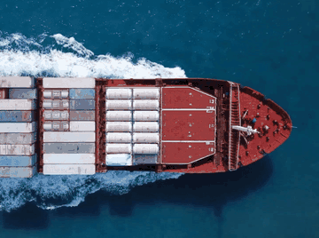{.fragment fragment-index="2" fig-alt="Animated aerial view of a container ship sailing through the water with a white wake" style="max-width: none; max-height: none; position: absolute; top: 395px; left: 472px; width: 336px; height: 250px; object-fit: cover; border-radius: 6px;"}

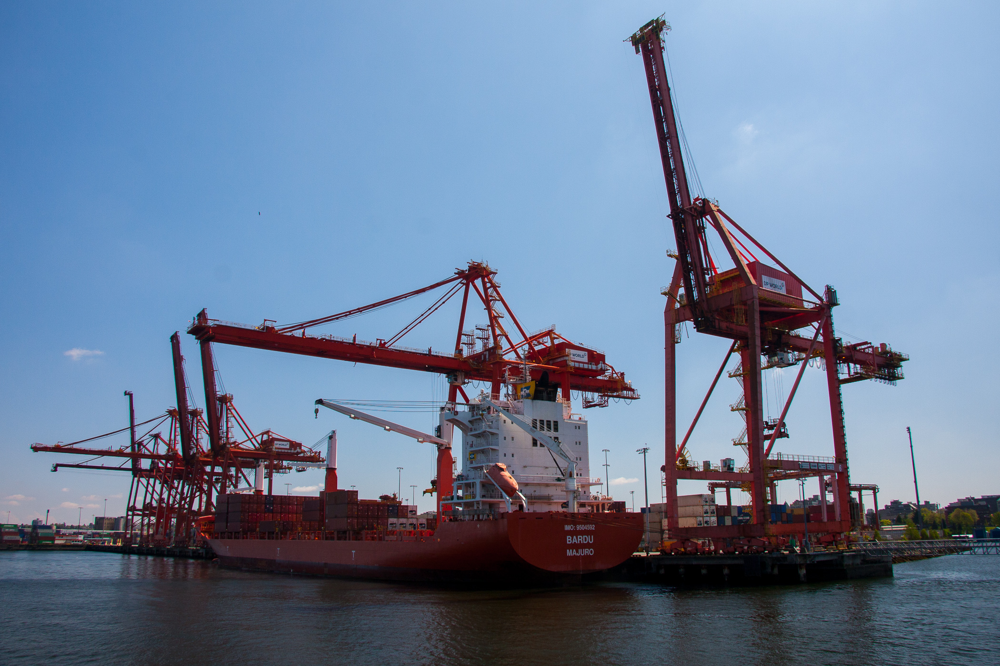{.fragment fragment-index="3" fig-alt="A container ship being loaded by gantry cranes in port" style="max-width: none; max-height: none; position: absolute; top: 395px; left: 872px; width: 336px; height: 250px; object-fit: cover; object-position: 50% 70%; border-radius: 6px;"}

## [How can a ship act as a wave buoy?]{.dtu-kicker} What is needed on board

::: notes
(0:30) The hardware is mostly already installed; the value is in the processing.
:::

::: {style="position: absolute; top: 180px; left: 60px; width: 560px; font-size: 0.85em;"}
- Inertial measurement unit (IMU) or motion reference unit (MRU)
- GPS
- Basic ship particulars and the loading condition
:::

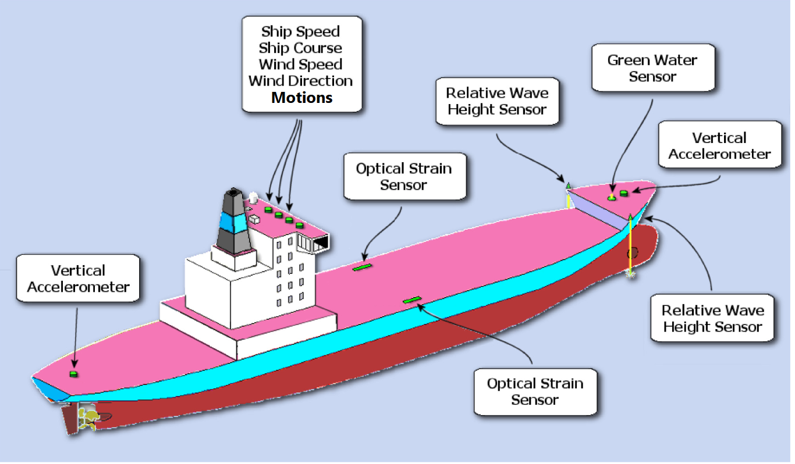{fig-alt="Illustration of a ship with onboard sensors: ship speed, course, wind and motion sensors on the bridge, vertical accelerometers at bow and stern, optical strain sensors on deck, relative wave height sensors and a green water sensor at the bow" style="max-width: none; max-height: none; position: absolute; top: 170px; left: 640px; width: 600px;"}

[Illustration from [Nielsen (2018)]{.dtu-blue}, doctoral thesis.]{.dtu-credit style="position: absolute; top: 540px; left: 640px; width: 600px; font-size: 12px;"}

<!-- ======================================================================= -->

<!-- BLOCK E: MAIN RESEARCH OUTCOMES (9:20–14:50)                             -->

<!-- ======================================================================= -->

## [Research outcomes]{.dtu-kicker} 1. From single ships to wave maps

::: notes
(1:00) Ships and buoys combined in a network produce wave information where no sensor exists. With the University of Exeter and the Met Office.
:::

[Coverage]{.dtu-tag style="position: absolute; top: 22px; right: 70px;"}

<!-- Text in a compact band above the figure -->
::: {style="position: absolute; top: 125px; left: 60px; width: 560px; font-size: 0.75em;"}
Ships and buoys combined in a **network** give wave information where no sensor exists.
:::

::: {style="position: absolute; top: 125px; left: 660px; width: 580px; font-size: 0.65em; line-height: 1.35;"}
[Mounet et al. (2023a)]{.dtu-blue}, *Deriving spatial wave data from a network of buoys and ships*, Ocean Eng. 281.
:::

<!-- Wide figure (4209 x 1336 px), full slide width -->
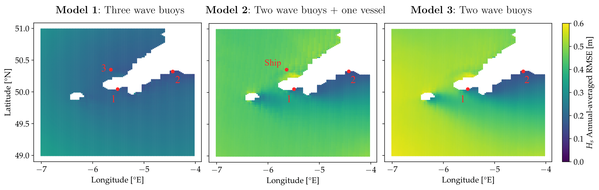{fig-alt="Three maps of annual-averaged RMSE of significant wave height off south-west England, from 0 to 0.6 m, for three network configurations of ships and wave buoys; the third model uses two wave buoys" style="max-width: none; max-height: none; position: absolute; top: 205px; left: 40px; width: 1200px;"}

[From [Mounet et al. (2023a)]{.dtu-blue}.]{.dtu-credit style="position: absolute; top: 605px; left: 40px; width: 1200px; text-align: right; font-size: 12px;"}

## [Research outcomes]{.dtu-kicker} 2. Ships that calibrate themselves

::: notes
(1:00) A ship's transfer functions can be learned from its own data, with confidence bands and without a tank test.
:::

[Uncertain filter]{.dtu-tag style="position: absolute; top: 22px; right: 70px;"}

::: {style="position: absolute; top: 110px; left: 60px; width: 570px; font-size: 0.6em;"}
The transfer functions can be **learned from the ship's own data**, with confidence bands.

- [Mounet et al. (2022)]{.dtu-blue}: simultaneous sea state estimation and transfer function tuning, network of DP ships.
- [Nielsen et al. (2022)]{.dtu-blue}: parameterised transfer functions with confidence bands.
- [Takami et al. (2026a)]{.dtu-blue}: blind identification of incident waves and transfer functions.
:::

<!-- Machine-learning teaser + case study (appears on one click, together with the plots) -->
::: {.fragment fragment-index="1" style="position: absolute; top: 262px; left: 60px; width: 570px; font-size: 0.62em; font-style: italic;"}
… moreover, **machine learning** methods can estimate the sea state **without any transfer functions** ([Nielsen et al., 2024a, 2024b]{.dtu-blue}).
:::

::: {.dtu-box .fragment fragment-index="1" style="position: absolute; top: 335px; left: 60px; width: 570px; height: 270px; font-size: 14px; line-height: 1.35;"}
```{=html}
<div style="font-weight: 700; color: #2F3EEA; margin-bottom: 6px;">Case study: midsize container vessel (<a href="#/references">Storhaug et al., 2007</a>)</div>
<div style="display: flex; gap: 12px; align-items: flex-start;">
  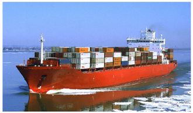
  <div>
    <b>Data recording</b>
    <ul style="margin: 2px 0 6px 0; padding-left: 16px;">
      <li>GPS (position and speed)</li>
      <li>Motions: heave, roll and pitch accelerations</li>
      <li>Wave radar (Wavex by MIROS)</li>
    </ul>
    <b>Data set</b>
    <ul style="margin: 2px 0 0 0; padding-left: 16px;">
      <li>About two years of data</li>
      <li>25-min time series sampled at 5 Hz</li>
      <li>5,261 open-water samples</li>
      <li>80% for training, 20% for testing</li>
    </ul>
  </div>
</div>
```
:::

<!-- ML-based estimates vs ERA5: Hs, Tp, Tz, mean direction (2 x 2 grid, 280 px each) -->
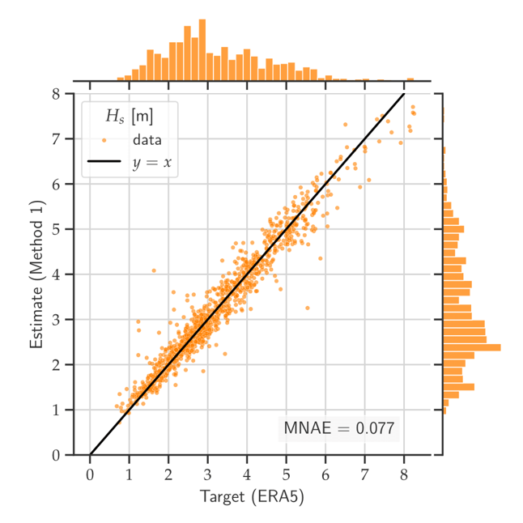{.fragment fragment-index="1" fig-alt="Scatter plot of significant wave height estimated by machine learning versus ERA5, from 0 to 8 m, with MNAE 0.077" style="max-width: none; max-height: none; position: absolute; top: 100px; left: 665px; width: 285px;"}

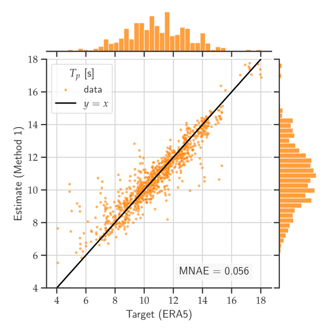{.fragment fragment-index="1" fig-alt="Scatter plot of peak wave period estimated by machine learning versus ERA5, from 4 to 18 s, with MNAE 0.056" style="max-width: none; max-height: none; position: absolute; top: 100px; left: 955px; width: 285px;"}

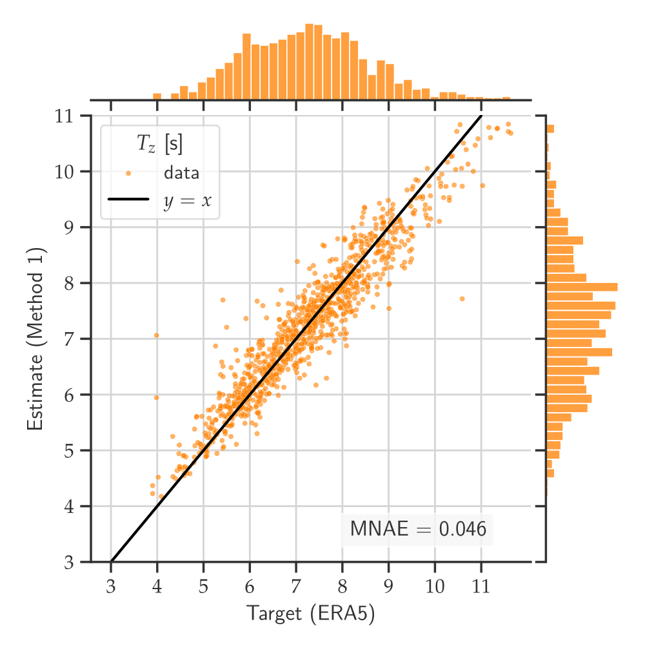{.fragment fragment-index="1" fig-alt="Scatter plot of zero up-crossing period estimated by machine learning versus ERA5, from 3 to 11 s, with MNAE 0.046" style="max-width: none; max-height: none; position: absolute; top: 385px; left: 665px; width: 285px;"}

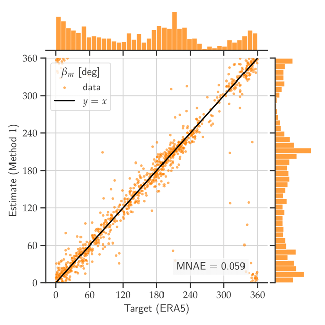{.fragment fragment-index="1" fig-alt="Scatter plot of mean wave direction estimated by machine learning versus ERA5, from 0 to 360 degrees, with MNAE 0.059" style="max-width: none; max-height: none; position: absolute; top: 385px; left: 955px; width: 285px;"}

## [Research outcomes]{.dtu-kicker} 3. Correcting for speed and shallow water

::: notes
(1:00) Speed and water depth distort what a ship "sees"; we now have corrections for both, including following seas. Danish angle: Kattegat and the Belts are shallow waters. \[check before saying how relevant the depth effect is there\]
:::

[Forward speed]{.dtu-tag style="position: absolute; top: 22px; right: 70px;"}

::: {style="position: absolute; top: 102px; left: 60px; width: 1160px; font-size: 0.62em;"}
- Doppler shift for ships advancing **at any forward speed**, including following seas: [Mounet et al. (2023b, 2025, 2026a)]{.dtu-blue}.
- Effect of **water depth** on the Doppler shift and on spectral response calculations: [Nielsen et al. (2026)]{.dtu-blue}.
:::

<!-- Interactive GeoGebra applet (embed code from geogebra.org/m/cnsf7r3y).
     Frame sized directly to 1190 x 514 px on the slide; GeoGebra scales the applet to fill it
     (no CSS transform, which made GeoGebra shrink the applet a second time).
     The static screenshot images/Mapping_encounter-intrinsic_wave_frequency.jpg is kept as a backup. -->
::: {style="position: absolute; top: 165px; left: 45px; width: 1190px; height: 514px; overflow: hidden;"}
```{=html}
<iframe scrolling="no" title="Mapping encounter / intrinsic wave frequency"
        data-src="https://www.geogebra.org/material/iframe/id/cnsf7r3y/width/1488/height/642/border/888888/sfsb/true/smb/false/stb/false/stbh/false/ai/false/asb/false/sri/false/rc/false/ld/false/sdz/false/ctl/false"
        width="1190" height="514"
        style="border: 0;"></iframe>
```
:::

## [Research outcomes]{.dtu-kicker} 4. A 1.4 m robot as a directional wave sensor

::: notes
(1:00) Small autonomous vessels can replace or extend buoys, but only if their hydrodynamics are modelled.
:::

[Size]{.dtu-tag style="position: absolute; top: 22px; right: 70px;"}

::: {style="position: absolute; top: 112px; left: 60px; width: 680px; font-size: 0.65em;"}
- Field campaign with the *Oshen C-star*: [Mounet et al. (2026b)]{.dtu-blue}.
- Hydrodynamic model estimation for a USV: [Mounet et al. (2024)]{.dtu-blue}.
:::

<!-- C-star photo, enlarged (was 265 x 298 at 86,374; now 400 x 450 at 60,190) -->
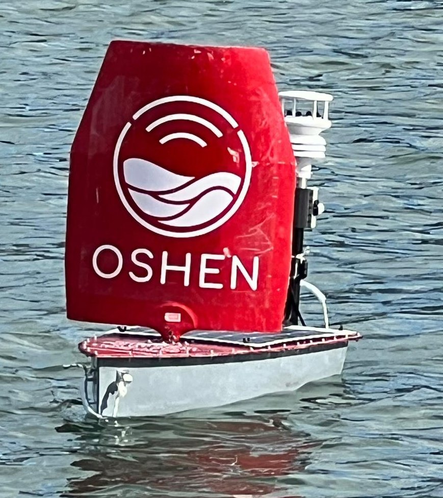{fig-alt="The Oshen C-star autonomous surface vessel at sea" style="max-width: none; max-height: none; position: absolute; top: 190px; left: 60px; width: 400px; height: 450px; object-fit: cover;"}

<!-- Sensor labels with leader lines (anchor points scaled with the photo, factor 1.51) -->

::: {style="position: absolute; top: 0px; left: 0px; width: 1280px; height: 720px; pointer-events: none;"}
```{=html}
<svg width="1280" height="720" viewBox="0 0 1280 720" xmlns="http://www.w3.org/2000/svg"
     font-family="serif" font-size="17" fill="black">
  <line x1="338" y1="309" x2="515" y2="309" stroke="black" stroke-width="1.4"/>
  <text x="525" y="315">Weather station</text>
  <line x1="155" y1="504" x2="515" y2="504" stroke="black" stroke-width="1.4"/>
  <text x="525" y="490">9 DoFs Inertial</text>
  <text x="525" y="510">Measurement Unit (IMU)</text>
  <line x1="190" y1="537" x2="515" y2="550" stroke="black" stroke-width="1.4"/>
  <text x="525" y="556">GPS sensor</text>
</svg>
```
:::

<!-- Directional spectra: vessel-as-a-buoy vs nearby buoy (1000 x 1052 px) -->
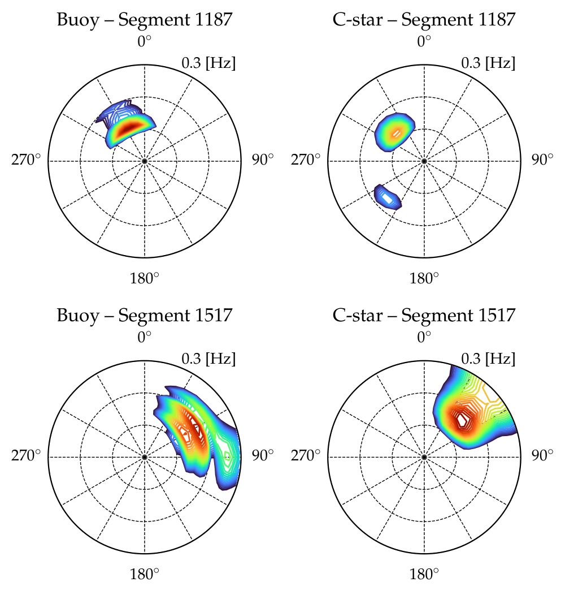{.fragment fragment-index="1" fig-alt="Directional wave spectra estimated by the buoy and by the C-star vessel for segments 1187 and 1517" style="max-width: none; max-height: none; position: absolute; top: 112px; left: 770px; height: 505px;"}

[Vessel-as-a-buoy versus nearby buoy.]{.dtu-blue .fragment fragment-index="1" style="position: absolute; top: 628px; left: 770px; width: 480px; text-align: center; font-size: 0.7em;"}

## [Research outcomes]{.dtu-kicker} 5. The same data reveals the ship's own condition

::: notes
(1:30) Motion data that tells you about the waves also tells you about hull loads and stability, a direct link to class and safety. Expect questions from classification societies here.
:::

[Beyond waves]{.dtu-tag style="position: absolute; top: 22px; right: 70px;"}

::: {style="position: absolute; top: 125px; left: 60px; width: 1160px; font-size: 0.65em;"}
- Hull girder structural integrity from wave-induced motions: [Mekki et al. (2026)]{.dtu-blue}, with DNV.
- Data-driven updating of ship roll-motion parameters: [Takami et al. (2026b)]{.dtu-blue}.
- Machine-learning-based wave estimates with uncertainty: [Nielsen et al. (2024b)]{.dtu-blue}.
:::

<!-- Diagram: measured motions in, four outputs out (stacked, evenly spaced; centres at y = 294, 389, 484, 579) -->

::: {.dtu-box style="position: absolute; top: 418px; left: 60px; width: 260px; text-align: center; font-size: 0.75em;"}
**Measured motions**
:::

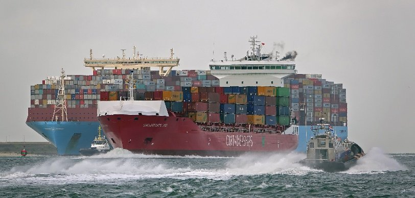{fig-alt="A large container ship" style="max-width: none; max-height: none; position: absolute; top: 335px; left: 420px; width: 400px;"}

["[MILAN MAERSK, MULTRATUG 33, CONTAINERSHIPS NORD & JEANINE PARQUI](https://www.flickr.com/photos/68359921@N08/48805747472)" by [kees torn](https://www.flickr.com/photos/68359921@N08) is licensed under [CC BY-SA 2.0](https://creativecommons.org/licenses/by-sa/2.0/).]{.dtu-credit style="position: absolute; top: 552px; left: 420px; width: 400px;"}

::: {.dtu-box style="position: absolute; top: 275px; left: 920px; width: 300px; text-align: center; font-size: 0.75em;"}
**Waves** (sea state)
:::

::: {.dtu-box .fragment fragment-index="1" style="position: absolute; top: 370px; left: 920px; width: 300px; text-align: center; font-size: 0.75em; background-color: #2F3EEA; color: white;"}
**Hull loads & stability**
:::

<!-- Speculative outputs: dashed border, semi-transparent -->
::: {.dtu-box .fragment fragment-index="2" style="position: absolute; top: 465px; left: 920px; width: 300px; text-align: center; font-size: 0.75em; border: 2px dashed #2F3EEA; background-color: rgba(47,62,234,0.06); color: rgba(0,0,0,0.65); font-style: italic;"}
Surface currents?
:::

::: {.dtu-box .fragment fragment-index="2" style="position: absolute; top: 560px; left: 920px; width: 300px; text-align: center; font-size: 0.75em; border: 2px dashed #2F3EEA; background-color: rgba(47,62,234,0.06); color: rgba(0,0,0,0.65); font-style: italic;"}
Wind?
:::

<!-- Arrows: motions -> ship -> waves (always shown) -->
::: {style="position: absolute; top: 0px; left: 0px; width: 1280px; height: 720px; pointer-events: none;"}
```{=html}
<svg width="1280" height="720" viewBox="0 0 1280 720" xmlns="http://www.w3.org/2000/svg">
  <defs><marker id="ah15" viewBox="0 0 10 10" markerUnits="userSpaceOnUse" markerWidth="16" markerHeight="16" refX="8" refY="5" orient="auto"><path d="M0,0 L10,5 L0,10 z" fill="black"/></marker></defs>
  <path d="M 325 437 L 410 437" fill="none" stroke="black" stroke-width="3" marker-end="url(#ah15)"/>
  <path d="M 830 420 C 870 415, 875 294, 910 294" fill="none" stroke="black" stroke-width="3" marker-end="url(#ah15)"/>
</svg>
```
:::

<!-- Arrow to hull loads & stability (step 1) -->
::: {.fragment fragment-index="1" style="position: absolute; top: 0px; left: 0px; width: 1280px; height: 720px; pointer-events: none;"}
```{=html}
<svg width="1280" height="720" viewBox="0 0 1280 720" xmlns="http://www.w3.org/2000/svg">
  <defs><marker id="ah15b" viewBox="0 0 10 10" markerUnits="userSpaceOnUse" markerWidth="16" markerHeight="16" refX="8" refY="5" orient="auto"><path d="M0,0 L10,5 L0,10 z" fill="#2F3EEA"/></marker></defs>
  <path d="M 830 432 C 870 430, 875 389, 910 389" fill="none" stroke="#2F3EEA" stroke-width="3" marker-end="url(#ah15b)"/>
</svg>
```
:::

<!-- Dashed arrows to the speculative outputs (step 2) -->
::: {.fragment fragment-index="2" style="position: absolute; top: 0px; left: 0px; width: 1280px; height: 720px; pointer-events: none;"}
```{=html}
<svg width="1280" height="720" viewBox="0 0 1280 720" xmlns="http://www.w3.org/2000/svg">
  <defs><marker id="ah15c" viewBox="0 0 10 10" markerUnits="userSpaceOnUse" markerWidth="16" markerHeight="16" refX="8" refY="5" orient="auto"><path d="M0,0 L10,5 L0,10 z" fill="#2F3EEA" fill-opacity="0.6"/></marker></defs>
  <path d="M 830 444 C 870 448, 875 484, 910 484" fill="none" stroke="#2F3EEA" stroke-opacity="0.6" stroke-width="3" stroke-dasharray="7 6" marker-end="url(#ah15c)"/>
  <path d="M 830 456 C 870 468, 875 579, 910 579" fill="none" stroke="#2F3EEA" stroke-opacity="0.6" stroke-width="3" stroke-dasharray="7 6" marker-end="url(#ah15c)"/>
</svg>
```
:::

<!-- ======================================================================= -->

<!-- BLOCK F: OPENNESS AND STANDARDS (14:50–19:40)                            -->

<!-- ======================================================================= -->

## [What could this mean for standards?]{.dtu-kicker} NetSSE: an open reference implementation

::: notes
(1:00) The methods are open source, documented and reproducible, which is what a standard needs to build on.
:::

::: {style="position: absolute; top: 165px; left: 60px; width: 720px; font-size: 0.75em;"}
[Open-source Python package]{.dtu-blue style="font-weight: 700;"}

1.  Analyse **buoy** data ([`analys.buoy`](https://netsse.readthedocs.io/en/latest/api/netsse/analys/buoy/index.html))
2.  Analyse **ship** data, wave-buoy analogy ([`analys.sawb`](https://netsse.readthedocs.io/en/latest/api/netsse/analys/sawb/index.html), [`analys.emep`](https://netsse.readthedocs.io/en/latest/api/netsse/analys/emep/index.html))
3.  **Doppler** correction ([`analys.dsa`](https://netsse.readthedocs.io/en/latest/api/netsse/analys/dsa/index.html))
4.  **Simulate** waves and vessel responses ([`simul.ship_resp`](https://netsse.readthedocs.io/en/latest/api/netsse/simul/ship_resp/index.html))
5.  Retrieve **ERA5** data ([`model.era5`](https://netsse.readthedocs.io/en/latest/api/netsse/model/era5/index.html))
:::

::: {style="position: absolute; top: 540px; left: 60px; width: 720px; font-size: 0.6em;"}
Documentation: <https://netsse.readthedocs.io/>

Source code: <https://gitlab.gbar.dtu.dk/regmo/NetSSE>
:::

{fig-alt="Python logo" style="max-width: none; max-height: none; position: absolute; top: 580px; left: 930px; width: 170px;"}

::: {style="position: absolute; top: 175px; left: 850px;"}
[{width="380" fig-alt="QR code to netsse.readthedocs.io" style="max-width: none; max-height: none;"}](https://netsse.readthedocs.io/en/latest/index.html)
:::

## [What could this mean for standards?]{.dtu-kicker} Where wave data enter standards and rules

::: notes
(1:30) Many standards consume wave data. To ask (not assert): does any of them specify how to estimate it from onboard motions, or how good the estimate must be? Someone in the room may know a counterexample.
:::

::: {style="position: absolute; top: 130px; left: 60px; width: 1160px; font-size: 22px;"}
| Standard / guidance | What the wave input is used for |
|------------------------|------------------------|
| ISO 15016 | Speed trials: correction for waves |
| IMO MSC.1/Circ.1228 | Guidance to the master for avoiding dangerous situations in adverse weather and sea conditions |
| ISO 19030 | Hull and propeller performance |
| Second-generation intact stability criteria, operational measures |  |
| IACS wave scatter data for design loads |  |
:::

::: {.dtu-box style="position: absolute; top: 470px; left: 60px; width: 1160px; text-align: center; font-size: 0.95em;"}
[Question:]{.dtu-blue} does any standard specify **how** to estimate waves from onboard motions, or **how good** the estimate must be?
:::

## [What could this mean for standards?]{.dtu-kicker} Three questions for the committee {#questions}

::: notes
(1:30) I would like your view on whether and where this belongs in standardisation. Leave this slide on screen during the Q&A.
:::

::: {.dtu-box style="position: absolute; top: 170px; left: 60px; width: 1160px; font-size: 0.8em;"}
[1.]{.dtu-blue style="font-weight: 700;"} Should there be **minimum metadata and sensor requirements** (IMU position, sampling rate, loading condition) so that ship motion data becomes reusable?
:::

::: {.dtu-box style="position: absolute; top: 320px; left: 60px; width: 1160px; font-size: 0.8em;"}
[2.]{.dtu-blue style="font-weight: 700;"} How should the **uncertainty** of a wave estimate be reported and accepted, for example in performance monitoring or trials?
:::

::: {.dtu-box style="position: absolute; top: 470px; left: 60px; width: 1160px; font-size: 0.8em;"}
[3.]{.dtu-blue style="font-weight: 700;"} Who **owns and shares** the data, given commercial sensitivity versus the public benefit for forecasting?
:::

<!-- ======================================================================= -->

<!-- BLOCK G: CLOSING (19:40–20:00)                                           -->

<!-- ======================================================================= -->

## Take-home messages

::: notes
(0:30) Ships can fill the wave observation gap, the methods exist and are open, and standards are the missing piece.
:::

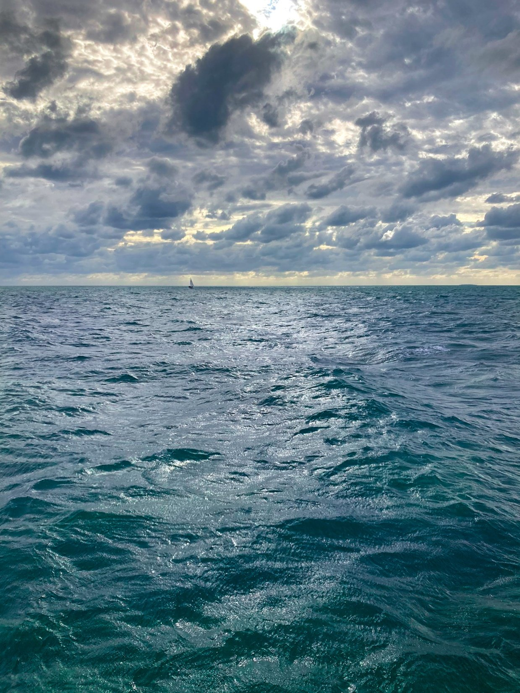{fig-alt="The sea under a cloudy sky" style="max-width: none; max-height: none; position: absolute; top: -4px; left: 740px; width: 540px; height: 680px; object-fit: cover;"}

::: {style="position: absolute; top: 125px; left: 60px; width: 650px; font-size: 0.86em; line-height: 1.35;"}
- Ships can **fill the wave observation gap**: they sail where buoys are absent, and networks of ships and buoys extend the coverage.
- The **wave buoy analogy** gives estimates in fair agreement with buoys and wave models, despite the ship's size, forward speed and uncertain filter.
  - Transfer functions require the loading condition and speed, but can be tuned from the ship's own data.
  - Machine learning needs no transfer functions and yields good sea-state parameters.
- The same motion data also reveal **hull loads and stability**.
- The methods **exist and are open** (NetSSE).
- Might **standards** be the missing piece?
:::

## References

::: {style="position: absolute; top: 150px; left: 40px; width: 590px; margin-top: 0; font-size: 13px; line-height: 1.3;"}
IMO (2020). *Fourth IMO Greenhouse Gas Study 2020*. International Maritime Organization, London.

IMO (2025). *Development of measures to prevent the loss of containers at sea: Estimate of containers lost at sea – 2025 update*. Submitted by the World Shipping Council (WSC), 30 June 2025. International Maritime Organization, London.

Mekki, M., Nielsen, U.D., Mounet, R.E.G., Storhaug, G. (2026). Data-driven estimation of hull girder structural integrity using wave-induced motions. *Mar. Struct.* 108, 104036.

Mounet, R.E.G., Nielsen, U.D., Brodtkorb, A.H., Tannuri, E.A., de Mello, P.C. (2022). Simultaneous sea state estimation and transfer function tuning using a network of dynamically positioned ships. *Appl. Ocean Res.* 129, 103367.

Mounet, R.E.G., Chen, J., Nielsen, U.D., Brodtkorb, A.H., Pillai, A.C., Ashton, I.G.C., Steele, E.C.C. (2023a). Deriving spatial wave data from a network of buoys and ships. *Ocean Eng.* 281, 114892.

Mounet, R.E.G., Nielsen, U.D., Brodtkorb, A.H. (2023b). Doppler shift approximation for predicting the wave-induced response of advancing vessels in following waves. *Proc. ASME OMAE 2023*, Vol. 5, V005T06A053.

Mounet, R.E.G., Nielsen, U.D., Brodtkorb, A.H., Øveraas, H., Dallolio, A., Johansen, T.A. (2024). Data-driven method for hydrodynamic model estimation applied to an unmanned surface vehicle. *Measurement* 234, 114724.

Mounet, R.E.G., Nielsen, U.D., Takami, T. (2025). Doppler shift approximation in seakeeping problems: a new formulation for ships advancing at any forward speed. *Proc. PRADS 2025*.

Mounet, R.E.G., Nielsen, U.D., Takami, T. (2026a). Approximating the Doppler shift in sea-wave spectra observed from an advancing floating platform. *Appl. Math. Model.* 157, 116922.

Mounet, R.E.G., Nielsen, U.D., Pillai, A.C., Ashton, I.G.C., Holman, F., Laverack, A., Steele, E.C.C. (2026b). Inferring directional wave spectra via motion sensing on ocean-going autonomous surface vessels. *Proc. ASME OMAE 2026*.
:::

::: {style="position: absolute; top: 150px; left: 660px; width: 590px; margin-top: 0; font-size: 13px; line-height: 1.3;"}
Munk, W.H. (2002). Testimony to the U.S. Commission on Ocean Policy, San Pedro, California, 18 April 2002. <https://govinfo.library.unt.edu/oceancommission/meetings/apr18_19_02/munk_statement.pdf>

Nielsen, U.D. (2018). *Sea state estimation based on measurements of wave-induced ship responses*. Doctoral thesis, Technical University of Denmark (DTU).

Nielsen, U.D., Mounet, R.E.G., Brodtkorb, A.H. (2022). Parameterised transfer functions with associated confidence bands. *Appl. Ocean Res.* 125, 103250.

Nielsen, U.D., Bingham, H.B., Brodtkorb, A.H., Iseki, T., Jensen, J.J., Mittendorf, M., Mounet, R.E.G., Shao, Y., Storhaug, G., Sørensen, A.J., Takami, T. (2023). Estimating waves via measured ship responses. *Sci. Rep.* 13, 17342.

Nielsen, U.D., Iwase, K., Mounet, R.E.G. (2024a). Comparing machine learning-based sea state estimates by the wave buoy analogy. *Appl. Ocean Res.* 149, 104042.

Nielsen, U.D., Iwase, K., Mounet, R.E.G., Storhaug, G. (2024b). Uncertainty-associated directional wave spectrum estimation from wave-induced ship responses using machine learning methods. *Ocean Eng.* 313, 119543.

Nielsen, U.D., Mounet, R.E.G., Takami, T. (2026). Investigation of depth-effects on the Doppler shift and the consequence in spectral response calculations for ships. *Ocean Eng.* 351, 124298.

Storhaug, G., Moe, E., Piedras Lopes, T.A. (2007). Whipping measurements onboard a midsize container vessel operating in the North Atlantic. In: *Int. Symp. on Ship Design and Construction*. Marintec, RINA, CMP and SNAME.

Takami, T., Nielsen, U.D., Mounet, R.E.G., Jensen, J.J., Mori, R., Komoriyama, Y. (2026a). Blind identification of incident waves and response transfer functions of a marine vessel based on measured responses. *Expert Syst. Appl.* 296, 129236.

Takami, T., Nielsen, U.D., Mounet, R.E.G., Sasa, K. (2026b). A data-driven scheme for updating of parameters for ship roll motion. *Ocean Eng.* 356, 125346.
:::

##  {#thanks}

::: notes
(0:10) Let us continue the conversation. Then go back to the "Three questions" slide for the Q&A.
:::

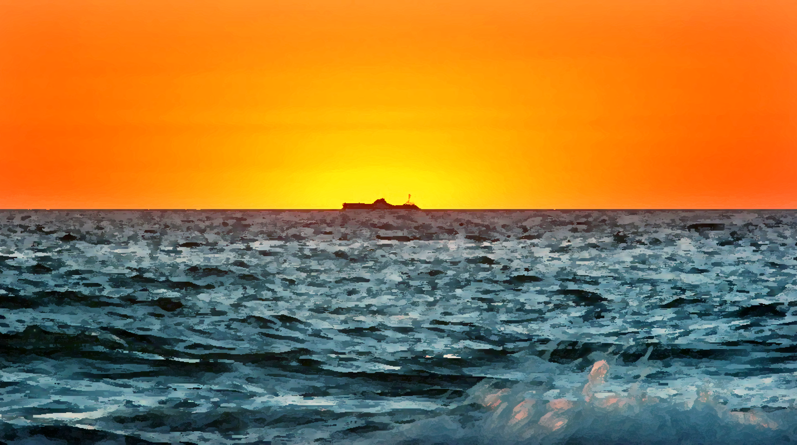{fig-alt="A ship silhouetted on the horizon against an orange sunset over a choppy sea" style="max-width: none; max-height: none; position: absolute; top: -4px; left: 96px; width: 907px; height: 680px; object-fit: cover; object-position: 48% 50%;"}

[["This ship has sailed"](https://www.flickr.com/photos/90963248@N00/286207771) by [Vince Alongi](https://www.flickr.com/photos/90963248@N00) is licensed under [CC BY 2.0](https://creativecommons.org/licenses/by/2.0/).]{.dtu-credit style="position: absolute; top: 660px; left: 104px; color: rgba(255,255,255,0.85); font-size: 11px;"}

::: {style="position: absolute; top: 60px; left: 1010px; width: 262px; text-align: center; font-size: 18px; line-height: 1.3;"}
[Thank you!]{.dtu-blue style="font-weight: 700; font-size: 1.4em;"}

[regmo\@dtu.dk](mailto:regmo@dtu.dk)
:::

::: {style="position: absolute; top: 170px; left: 1051px;"}
[{width="180" fig-alt="QR code to netsse.readthedocs.io" style="max-width: none; max-height: none;"}](https://netsse.readthedocs.io/en/latest/index.html)
:::

[`netsse.readthedocs.io`]{style="position: absolute; top: 355px; left: 1010px; width: 262px; text-align: center; font-size: 12px;"}

::: {style="position: absolute; top: 385px; left: 1010px; width: 262px; text-align: center; font-size: 12px; line-height: 1.3;"}
I am grateful for financial support by [Orients Fond, Denmark]{.dtu-blue} and by [Danmarks Frie Forskningsfond, Denmark]{.dtu-blue}.

Moreover, the support from the [Japan Society of Naval Architects and Ocean Engineers (JASNAOE)]{.dtu-blue} collaborative research program is greatly acknowledged.
:::

<!-- Funder logos: two small logos side by side, wide JASNAOE logo underneath -->
{fig-alt="A/S D/S Orient's Fond logo" style="max-width: none; max-height: none; position: absolute; top: 515px; left: 1022px; height: 46px;"}

{fig-alt="Danmarks Frie Forskningsfond logo" style="max-width: none; max-height: none; position: absolute; top: 521px; left: 1150px; height: 34px;"}

{fig-alt="JASNAOE logo" style="max-width: none; max-height: none; position: absolute; top: 575px; left: 1026px; width: 230px;"}